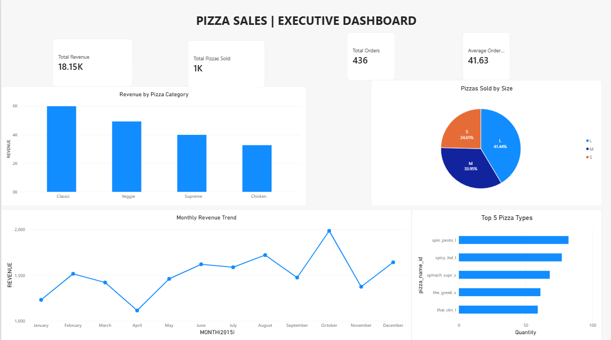

# 🍕 Pizza Sales Analysis | Power BI Executive Dashboard

An interactive Power BI dashboard that turns raw pizza sales data into clear, actionable business insights.

## 📸 Dashboard Preview



## 🎯 Project Objective

Analyze pizza sales to understand revenue drivers, customer preferences, and seasonal trends, and to support better menu, pricing, and inventory decisions.

## 📊 Key KPIs

| KPI | Value |
|---|---|
| Total Revenue | $18.15K |
| Total Pizzas Sold | ~1K |
| Total Orders | 436 |
| Average Order Value | $41.63 |

## 🔍 Key Insights

- **Classic** is the top-performing category by revenue (~$6K), followed by Veggie, Supreme, and Chicken.
- **Large (L)** pizzas make up 41.44% of units sold, ahead of Medium (33.95%) and Small (24.61%).
- Revenue **peaked in October** (~$2K) and dipped in **April** (~$1.1K).
- Top sellers include Spin Pesto (L), Spicy Italian (L), and Spinach Supreme (S).

## 💡 Business Recommendations

- Promote and bundle Classic and Large-size pizzas to increase average order value.
- Plan inventory and staffing around peak months, and run offers in slow months.
- Use the Top 5 list to optimize the menu and reduce waste.

## 🛠️ Tools & Skills

- **Excel:** data preparation and cleaning
- **Power BI:** data modeling, DAX measures, visualization
- **Skills:** KPI design, dashboard storytelling, business analysis

## 📁 Repository Structure

```
├── data/        → Source dataset (Excel)
├── dashboard/   → Power BI file (.pbix)
├── images/      → Dashboard screenshot
└── README.md    → Project documentation
```

## ▶️ How to Use

1. Download the repository (Code → Download ZIP).
2. Open `dashboard/pizza-sales-dashboard.pbix` in **Power BI Desktop**.
3. If prompted, update the data source path to `data/pizza_sales_dataset.xlsx`.

## 👤 Author
SHUBHAM THUBE

## [LinkedIn] 
         https://www.linkedin.com/in/shubham-thube-7b5761251/
## [Email]
         srt9637600168@gmail.com

⭐ If you found this project useful, feel free to star the repository!
